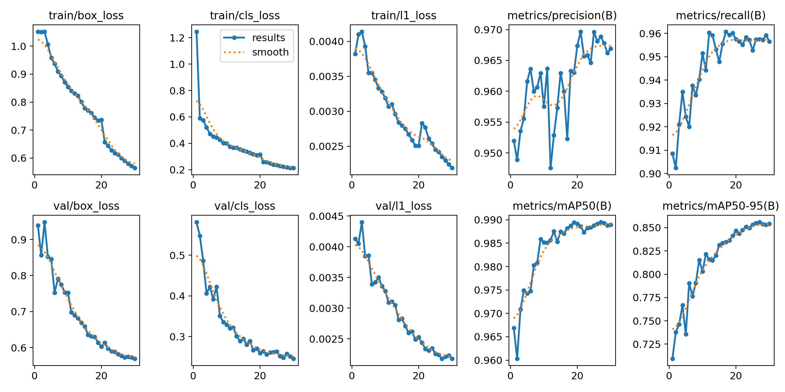

# License Plate Detection with YOLO26s

A computer vision project that detects vehicle license plates in images using **YOLO26s**. The application can draw bounding boxes around detected plates and crop each plate for further inspection.

## Project Highlights

- License plate detection using YOLO26s.
- Confidence threshold control during inference.
- Bounding-box visualization with detection confidence.
- Plate cropping with configurable padding around the detected plate.
- Simple Gradio interface for uploading images and viewing results.
- Export cropped plates as a ZIP archive.

> This project performs **detection and cropping only**. It does not include OCR or license-plate text recognition.

## Dataset

The model was trained using the Car Plate dataset from Roboflow Universe:

[**Car Plate Dataset — Roboflow Universe**](https://universe.roboflow.com/zara-hara/car-plate-k6xij/dataset/26)

Please review the dataset's license and usage terms on Roboflow before redistributing the data or using it commercially.

## Model

- **Architecture:** YOLO26s
- **Task:** Object detection
- **Target class:** License plate
- **Input:** Vehicle images
- **Output:** Bounding boxes around detected license plates

## Training Results

The training-results plots are shown below.



The provided plots indicate the following approximate final metrics:

| Metric | Approx. final value |
|---|---:|
| Precision | 0.967 |
| Recall | 0.957 |
| mAP@50 | 0.989 |
| mAP@50–95 | 0.854 |

Values are estimated from the supplied chart; consult the original Ultralytics `results.csv` for exact values.

## Requirements

- Python 3.10 or newer recommended
- Dependencies listed in `req.txt`
- Trained YOLO weights (`best.pt`)

Install dependencies:

```bash
pip install -r req.txt
```

## Run the App

1. Clone or download this repository.
2. Put your trained model weights in the project, or update `MODEL_PATH` in `app.py` to point to your `best.pt`.
3. Install dependencies:

   ```bash
   pip install -r req.txt
   ```

4. Start the application:

   ```bash
   python app.py
   ```

5. Open the local Gradio URL printed in the terminal and upload an image.

## Example Project Structure

```text
project/
├── app.py
├── req.txt
├── README.md
├── results.png
└── runs/
    └── .../
        └── weights/
            └── best.pt
```

The actual model path may differ depending on where training outputs were saved.

## Notes

- Lowering the confidence threshold can increase detections but may also introduce false positives.
- Increasing crop padding preserves some surrounding context around each plate.
- Results depend on image quality, lighting, camera angle, and similarity between the input images and the training dataset.
- The reported metrics are evaluation results from the supplied plots, not a guarantee of performance on all real-world images.

## License

Check the dataset license and the licenses of all dependencies and pretrained components before redistributing this project.
